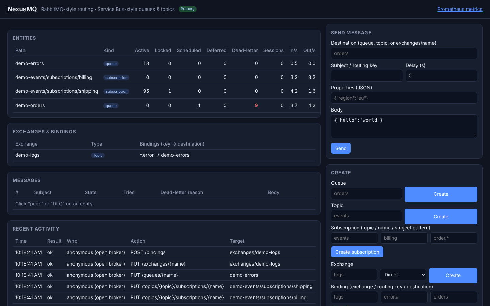
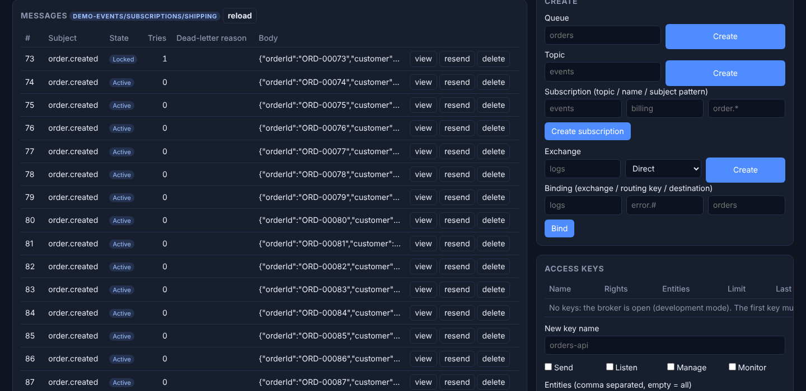
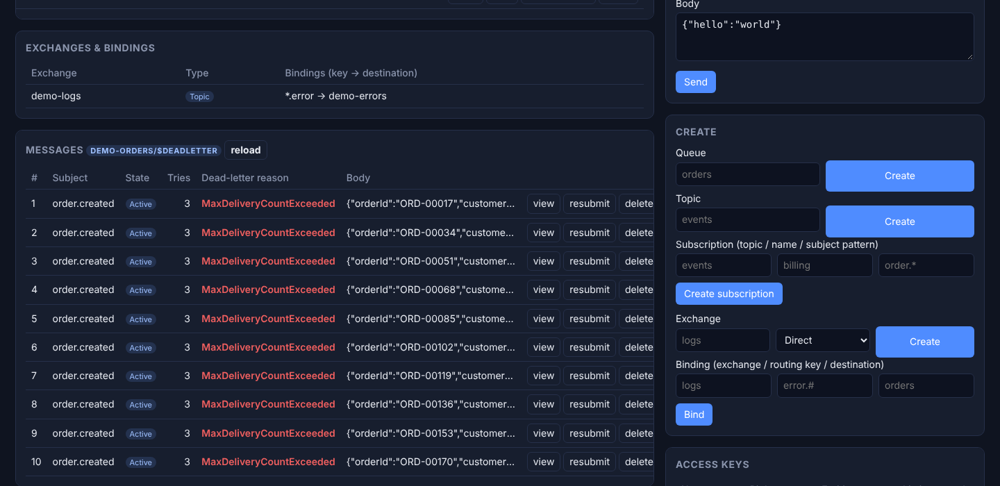
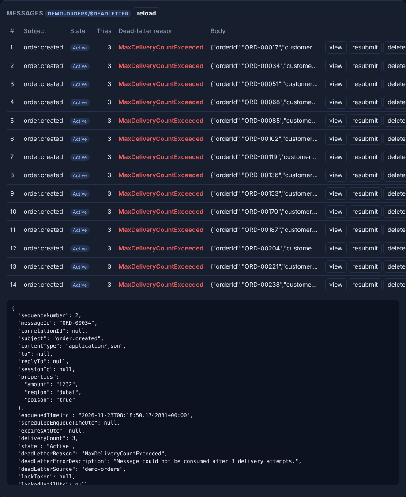
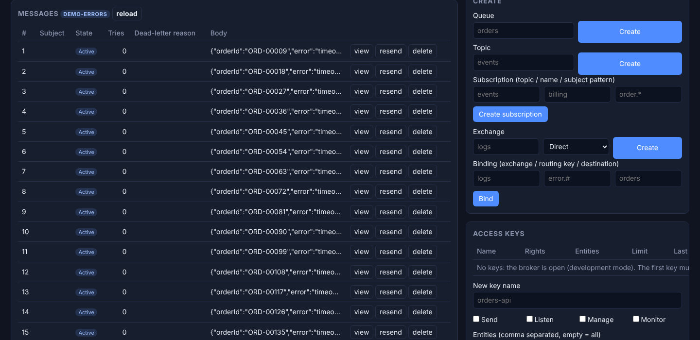
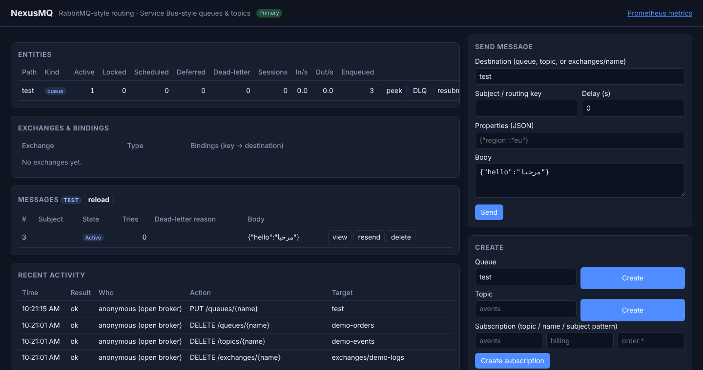

<div dir="rtl">

# دليل الاستخدام خطوة بخطوة — NexusMQ
*(Step-by-step guide, Arabic with the English words you see on screen)*

هذا الدليل يوضح كيف تشغّل NexusMQ، وتفتح لوحة التحكم (Dashboard) في المتصفح، وتشغّل بيانات تجريبية حتى ترى النظام وهو يعمل فعلياً.

---

## الخطوة 1: تشغيل الخادم (Start the server)

اختر **طريقة واحدة**:

| الطريقة | ماذا تفعل |
|---|---|
| **من مجلد الإعداد** (setup) | افتح `C:\projects-claude\NexusMQ\setup` واضغط مرتين على **`start-server.cmd`**. ستظهر نافذة سوداء — اتركها مفتوحة. |
| **من Visual Studio** | افتح `NexusMQ.sln`، اختر المشروع **NexusMQ.Server** كمشروع بدء (Startup Project)، ثم اضغط **F5**. |

عندما ترى في النافذة سطراً مثل `Now listening on: http://localhost:5680` فالخادم جاهز.

> ملاحظة: إذا لم يكن مجلد `setup` موجوداً، أنشئه بالأمر التالي في PowerShell من مجلد المشروع:
> `.\scripts\make-setup.ps1`

---

## الخطوة 2: فتح لوحة التحكم (Open the dashboard)

افتح المتصفح على العنوان: **http://localhost:5680**

في البداية ستكون الجداول فارغة لأنه لا توجد طوابير (Queues) بعد. هذا طبيعي.

---

## الخطوة 3: تشغيل البيانات التجريبية (Run the demo)

افتح نافذة **أوامر جديدة** (Command Prompt) في مجلد `setup` واكتب:

```
nexusmq demo
```

هذا الأمر يعمل لمدة **5 دقائق** (أو `nexusmq demo --minutes 10` لمدة أطول، و **Ctrl+C** لإيقافه) ويقوم بالتالي:

| ما يُنشئه | الاسم | ماذا يحدث فيه |
|---|---|---|
| طابور طلبات (Queue) | `demo-orders` | تُرسل طلبات شراء (بأسماء عملاء عربية وإنجليزية) وتُعالَج فوراً. بعض الطلبات "تالفة" عمداً فتفشل 3 مرات ثم تنتقل إلى طابور الرسائل الميتة. |
| موضوع أحداث (Topic) | `demo-events` | كل طلب يُنشر كحدث إلى اشتراكين: **billing** (فقط الطلبات التي مبلغها أكبر من 500) و **shipping** (كل الطلبات، لكن معالجته بطيئة عمداً فيتراكم فيه رسائل). |
| موزّع (Exchange) | `demo-logs` | رسائل الأخطاء التي مفتاحها ينتهي بـ `.error` تُوجَّه تلقائياً إلى الطابور `demo-errors`. |
| رسالة مجدولة | داخل `demo-orders` | رسالة تظهر بعد دقيقتين (Scheduled). |

في نافذة الأوامر سترى كل 3 ثوانٍ سطراً يوضح ما يحدث:

```
  sent   184 orders | processed   173 | failed attempts  30 | billing  127 | shipping   77 | errors logged  20
```

- **sent**: عدد الطلبات المرسلة.
- **processed**: عدد الطلبات التي عولجت بنجاح.
- **failed attempts**: محاولات فاشلة (الطلبات التالفة).
- **billing / shipping**: ما وصل لكل اشتراك.
- **errors logged**: رسائل الأخطاء المرسلة عبر الموزّع.

---

## الخطوة 4: قراءة لوحة التحكم (Read the dashboard)

ارجع إلى المتصفح. الأرقام تتحدث تلقائياً كل ثانيتين:



### جدول الكيانات (ENTITIES) — معنى كل عمود

| العمود | المعنى |
|---|---|
| **Path** | اسم الطابور أو الاشتراك |
| **Kind** | النوع: `queue` طابور، `subscription` اشتراك في موضوع |
| **Active** | رسائل تنتظر من يستلمها. في `shipping` يكبر هذا الرقم لأن المعالجة بطيئة (تراكم Backlog). |
| **Locked** | رسائل استلمها مستهلك ويعالجها الآن |
| **Scheduled** | رسائل مجدولة لوقت لاحق |
| **Dead-letter** | رسائل فشلت ونُقلت للطابور الميت (يظهر بالأحمر) |
| **In/s – Out/s** | عدد الرسائل الداخلة والخارجة في الثانية — يثبت أن النظام يعمل الآن |

### جدول الموزّعات (EXCHANGES & BINDINGS)
يوضح قواعد التوجيه، مثلاً: `*.error → demo-errors` أي كل رسالة مفتاحها ينتهي بـ `.error` تذهب إلى `demo-errors`.

---

## الخطوة 5: تصفح الرسائل (Browse messages — "peek")

في صف **`demo-events/subscriptions/shipping`** اضغط زر **peek**. تظهر الرسائل المنتظرة في قسم **MESSAGES** بدون أن تُسحب من الطابور:



---

## الخطوة 6: الرسائل الميتة (Dead-letter queue — "DLQ")

في صف **`demo-orders`** اضغط زر **DLQ**. ترى الطلبات التي فشلت 3 مرات، والسبب بالأحمر `MaxDeliveryCountExceeded` (تجاوز عدد المحاولات):



اضغط **view** بجانب أي رسالة لرؤية كل تفاصيلها: الخصائص، عدد المحاولات، سبب الفشل، ومصدرها:



الأزرار المتاحة لكل رسالة:
- **resubmit**: إعادتها إلى الطابور الأصلي لتُعالَج من جديد (بعد إصلاح المشكلة).
- **delete**: حذف هذه الرسالة فقط.
- زر **resubmit DLQ** في جدول الكيانات يعيد **كل** الرسائل الميتة دفعة واحدة.

---

## الخطوة 7: رسائل الأخطاء الموجّهة (Routed error logs)

في صف **`demo-errors`** اضغط **peek**. هذه رسائل لم يرسلها أحد إلى هذا الطابور مباشرة — بل أُرسلت إلى الموزّع `demo-logs` وهو وجّهها حسب القاعدة `*.error`:



---

## الخطوة 8: جرّب بنفسك من لوحة التحكم (Try it yourself)

على الجانب الأيمن:

1. **CREATE → Queue**: اكتب `test` واضغط **Create**. سيظهر طابور جديد في الجدول.
2. **SEND MESSAGE**: في Destination اكتب `test`، وفي Body اكتب `{"hello":"مرحبا"}`، ثم **Send**. سيصبح Active = 1.
3. اضغط **peek** على `test` لترى رسالتك.



---

## الخطوة 9: من سطر الأوامر (Command line)

من نافذة الأوامر في مجلد `setup`:

| الأمر (Command) | ماذا يفعل |
|---|---|
| `nexusmq stats` | كل الطوابير وأعداد رسائلها |
| `nexusmq create queue test` | إنشاء طابور اسمه test |
| `nexusmq send test "مرحبا من سطر الأوامر"` | إرسال رسالة |
| `nexusmq peek test` | تصفح الرسائل بدون سحبها |
| `nexusmq receive test` | استلام رسالة وإنهاؤها (تُحذف من الطابور) |
| `nexusmq help` | قائمة كل الأوامر |

---

## الخطوة 10: من برنامجك (From your own C# app)

أضف الحزمة **NexusMQ.Client** (من مجلد `nupkg` — انظر `docs/USING-IN-YOUR-PROJECT.md`) ثم:

```csharp
using NexusMQ.Client;

await using var client = new NexusClient("http://localhost:5680");
await client.Admin.CreateQueueAsync("orders");

// إرسال
await client.CreateSender("orders").SendMessageAsync(new NexusMessage("{\"orderId\":1}"));

// استقبال ومعالجة مستمرة
var processor = client.CreateProcessor("orders");
processor.ProcessMessageAsync += async args =>
{
    Console.WriteLine(args.Message.BodyAsString);   // انتهاء الدالة بنجاح = تمت المعالجة
};
processor.ProcessErrorAsync += args => Task.CompletedTask;
await processor.StartProcessingAsync();
```

إذا رمت الدالة استثناء (Exception) تُعاد الرسالة لاحقاً، وبعد عدد المحاولات المسموح تذهب للطابور الميت — تماماً مثل الطلبات التالفة في العرض التجريبي.

---

## الخطوة 11: التنظيف (Clean up)

لحذف بيانات العرض التجريبي:

```
nexusmq delete queue demo-orders
nexusmq delete queue demo-errors
nexusmq delete topic demo-events
nexusmq delete exchange demo-logs
```

أو احذف المجلد `setup\server\data` والخادم متوقف لحذف **كل** البيانات.

---

## مشاكل شائعة (Troubleshooting)

| المشكلة | الحل |
|---|---|
| المتصفح لا يفتح الصفحة | تأكد أن نافذة الخادم مفتوحة وفيها `Now listening on`. |
| `cannot reach NexusMQ at http://localhost:5680` | الخادم غير مشغّل، أو يعمل على منفذ آخر. |
| `dotnet` غير معروف | الإعداد "portable" يحتاج .NET 10. استخدم النسخة `win-x64` من صفحة الإصدارات على GitHub (لا تحتاج .NET). |
| تريد أن يعمل الخادم مع تشغيل Windows | شغّل PowerShell **كمسؤول** (Administrator) ثم `setup\install-service.ps1` — يُثبَّت كخدمة Windows تعمل تلقائياً وتظهر في `services.msc`، ويعيد Windows تشغيلها إذا توقفت. لإزالتها: `setup\uninstall-service.ps1`. |
| الوصول من جهاز آخر | اضبط مفتاح وصول `NexusMQ:ApiKey` في `setup\server\appsettings.json` أولاً، ثم شغّل بـ `set NEXUSMQ_URLS=http://0.0.0.0:5680`. |

</div>
